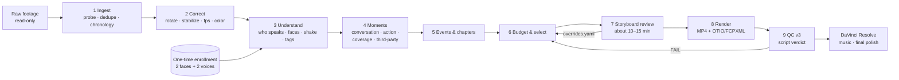

# magicvideo: Travel Film Pipeline v3 Proposal

**Status:** Proposal for review
**Date:** 2026-11-05
**Replaces:** `travel-footage-analyzer`, `travel-video-master-editor`, `couple-travel-documentary-editor` (v2)
**Evidence base:** the v2 reviewer package (3 skills, 4 Python scripts, 5 QC reports, 2 EDLs)
**Decisions:** recorded in §11
**Cameras:** Insta360 X6 (360°), DJI Osmo Nano, DJI Osmo Pocket 4P, phones
**Implementation:** see [IMPLEMENTATION_BRIEF.md](IMPLEMENTATION_BRIEF.md)

---

## 0. Summary

The problems in the current films are cut-off conversations, chopped scenes, shaky shots, wrong orientation, and 5–10 minutes spent on roads or on other people. These aren't tuning problems. Six v2 design decisions cause them, and each one shows up in v2's own QC reports and EDLs (§1).

v3 changes the design, not the thresholds:

1. **Code makes the cut; AI only describes the footage.** One Python pipeline plus one `policy.yaml`. An agent (Antigravity or Claude) runs the commands and reads the reports. It is no longer the editor. The same footage with the same policy gives the same film.
2. **Protect the two partners' voices, not every voice.** Speaker recognition is added next to face recognition, so guides, waiters, performers and strangers lose the "voice-first, never cut" protection.
3. **Edit in moments, not VAD segments.** A conversation runs as one unit from the first line to the last laugh. v3 no longer cuts every pause over 3 s.
4. **Each event gets a time budget, filled with its best shots.** v2 trimmed every road clip to 8 s and kept all of them. In v3 a drive gets about 30 s, made of the 5–8 best, most different shots.
5. **Fix footage before rejecting it.** v3 auto-rotates, gyro-stabilizes and reframes with face tracking. A vertical selfie of the couple is never dropped just for being vertical.
6. **A short human review before rendering, then finishing in DaVinci Resolve.** About 10–15 minutes of storyboard review per trip. The pipeline also exports an editable timeline, and music stays a manual step.
7. **360° footage from the Insta360 X series is a source type of its own.** For each moment the planner chooses where a virtual camera looks, so these clips work in both 16:9 and 9:16 masters (§7).

---

## 1. Diagnosis: what v2 actually does

### 1.1 Symptom → root cause → evidence

| What you see | Root cause in v2 | Evidence from the package |
|---|---|---|
| **Conversations trimmed or choppy** | Voice-first keeps only the VAD/Whisper speech segments and shortens every pause over 3 s to 1 s. Quiet replies, laughs, reactions and "look at that" moments sit in those gaps. Each removal is a jump cut on the same camera angle. | Seoul EDL: **289 of 335 cuts (86%) are jump cuts inside the same clip**. 253 of them splice speech to speech, removing a median **8.3 s** each time. |
| **"100% dialogue retained", but it doesn't feel that way** | Retention is measured with the same detector that chose the cuts, so it can't fail. Speech the VAD missed was never counted as dialogue. | All 5 reports say exactly 100.0%, even though §12.16 says retention must "never [be] forced to 100%" and v002 removed defects inside speech windows. |
| **Other people's scenes run 5–10 min** | Speech isn't tied to a speaker. When a guide, waiter, coffee master or performer talks, it counts as "dialogue" and gets the top-priority never-cut rule. | Japan: the Kanazawa coffee master (`NO_PRINCIPAL_PERSON`) gets **about 2 min** (62.9 + 32.0 + 25.1 s), and the report counts it in Partner B's balance notes. Seoul: **94%** of the runtime is `DIALOGUE_VOICE_FIRST`. The café street runs **13.0 min** and the breakfast buffet **11.9 min**. |
| **Too long on the road** | Caps apply per *shot*, not per *event*. "Trim B-roll over 10 s to its best 8 s" shortens every clip but keeps all of them, and the road-trip grammar allows 5 min per drive. | Bolivia: **166 clips trimmed to 8 s**, about 22 min of B-roll from those alone. The final mix is **75% transit** against a 10% target, with **1.3%** joint couple and **0.9%** food, and it was reported as **PASS**. |
| **Shaky scenes** | There is no stabilization step anywhere. Detection only catches "violent" runs of at least 0.5 s (Laplacian plus global motion at 4 fps), so ordinary walking shake passes. The master is also forced to exactly 23.976 fps without interpolation. If the sources are 25/30/50/60 fps, frames are dropped unevenly, which adds judder to every pan and walk and reads as extra shake. | master-editor §14 says "Exactly 23.976 fps", while couple-doc §17 and `technical_standards.md` say to use the dominant source rate. No skill has a `vidstab` or Gyroflow step. |
| **Orientation problems** | Three rules conflict: pad or reframe (couple-doc, editorial_rules), blurred side wings (editorial_rules), and **hard-reject portrait** footage in 16:9 output (master-editor). Phone selfies of the couple are usually vertical, so whole couple moments disappear from landscape films. Sideways clips are found only through "rotated faces". | master-editor §12.6 and §12.15 vs. couple-doc §17 vs. editorial_rules §5G. |
| **Scenes cut off at the start or end** | 82 of the 151 Japan segments are `KEEP_STREAM_COPY`. A stream copy can only start on a keyframe, so in-points move. Concatenating stream-copied pieces risks clipped starts, frozen frames and A/V offset. Audio is AAC-encoded per segment and then joined, so encoder padding adds up as drift. | Japan EDL. Bolivia A/V drift is **116.9 ms** against a 41.7 ms limit. The Japan master's H.264 profile is "Constrained Baseline", but the spec says High. |
| **Chapters don't match the trip** | Chapter names come from a template, not from the footage. | Pakistan, Istanbul and Seoul have the same five chapter names. Seoul's "03_Scenic_Landmark_Expedition" is 25 min of breakfast buffet and café street, and "04_Immersive_Nature_and_Horizons" is a KBBQ dinner. |
| **QC says PASS when it isn't** | The agent writes its own report. Thresholds live in prose and the verdict is typed by hand. `qc_validator.py` decides PASS from decode success and `width == 1920` alone. Loudness never affects the verdict, and the script targets −18 LUFS while the editor targets −23. | Japan LRA 10.6 (limit 7): PASS. Japan ch03 TP −1.46 dBTP (limit −1.5): PASS. Bolivia drift 116.9 ms: PASS. Pakistan people/destination split 83/17 (target 50/50 ± 7): PASS. Istanbul's loudnorm output says `"normalization_type": "dynamic"`, not linear. |

### 1.2 The three skills contradict each other

An LLM following about 100 KB of instructions resolves these conflicts differently on every run. Writing more instructions can't fix that. The fix is to take the rules out of prose (§2).

| Topic | couple-travel-documentary-editor | travel-video-master-editor | editorial_rules / technical_standards |
|---|---|---|---|
| Loudness target | −18 LUFS (HOME) | −23 LUFS | −18 default |
| `dynaudnorm` on the master | forbidden | required (`f=150:g=15`) | not mentioned |
| Vertical clips in 16:9 | reframe / pad / wings | hard reject, wings forbidden | pad / blurred wings |
| Silence trimming | ≥ 5 s → keep 0.8–1.5 s | > 3 s → 1 s | ≥ 5 s |
| Tier-1 landmark length | 90 s – 4 min | 45–80 s (2–3 min with talk) | 90 s – 4 min |
| Frame rate | dominant source | exactly 23.976 | dominant source |
| Runtime target | 70–85% of usable footage | no quota | 70–85% |
| Music | cue sheet and CapCut prompts required | forbidden | required |

### 1.3 Identity coverage is thin

- **Face sampling is sparse.** Faces are searched on extracted keyframes: the coarse pass takes one every 5–8 s at 480 px, and denser frames only appear where the agent chooses to refine. The IoU tracker counts its 5-frame gap in *list positions*, not time, so a "track" can link detections tens of seconds apart and spread one identity across different people. The result: Japan shows **0.4 min** of joint couple footage, and in Bolivia Partner B has **14** detections against Partner A's 142.
- **The person filming is invisible.** Partner B has 8 reference crops against Partner A's 34, which fits someone who is mostly behind the camera. Face-only identity can't see that person, but the audio can hear them. Speaker ID closes this gap.
- **Some reference vectors are junk.** When `detect_and_extract()` finds no face in a small image, it embeds the whole unaligned image. Those vectors then end up in references and clusters.
- **The selfie rule uses gender.** It is written as "male / female", while the identity contract forbids inferring gender. v3 makes it a per-partner setting instead (`silent_solo_shot_max_s: {PARTNER_A: 4, PARTNER_B: 0}`).

### 1.4 What v2 got right (kept in v3)

- Read-only sources and versioned outputs.
- Deletion-only face review.
- Cached embeddings.
- The 5-act meal and landmark grammars, used as *ordering* templates.
- Chapter-level re-rendering.
- SHA-256 checksums and faststart checks.
- Honest QC as a principle. v3 enforces it in code instead of asking for it in prose.

---

## 2. v3 design principles

1. **Code decides, models describe.** Models produce labels: who is speaking, what is in frame, how shaky a shot is. A deterministic planner turns labels plus `policy.yaml` into a timeline.
2. **One policy file.** Every threshold lives in `policy.yaml`. Skills and agents read it, and nobody restates numbers in prose.
3. **The moment is the unit of editing.** There are four kinds: conversation, action, coverage shot and third-party moment.
4. **Couple moments are protected; everything else gets a time budget.**
5. **Correct first, reject last.**
6. **A cheap human review comes before the expensive render.**
7. **The output is editable.** An OTIO/FCPXML timeline ships with every MP4.
8. **QC is measured independently and decided by a script.** Neither the agent nor the cutter grades its own work.

---

## 3. Pipeline



### 3.1 Ingest and chronology

- Run the ffprobe inventory (reuse `probe_inventory.py`) and a SHA-256 duplicate check.
- **Correct device clock offsets.** Overlapping recordings from different cameras are aligned by audio cross-correlation. Each device's offset is stored in `devices.yaml`, and the user can override it (for example, "the Sony clock was 1 h behind").
- Days are the local calendar day from capture time plus timezone, using GPS when available.

### 3.2 Correct, before any analysis

- **Orientation.** Read the rotation metadata first, then check the content: run the face detector, plus horizon and text cues, at 0/90/180/270° on 5 sampled frames, and take the majority. The result is stored as `orientation_fix` per clip, and analysis proxies are rendered already upright.
- **Stabilization.** Use gyro-based stabilization with [Gyroflow](https://gyroflow.xyz) (open source, batch/CLI rendering) for cameras that record motion data, such as GoPro, DJI Action series and many Sony bodies. For other footage, fall back to a two-pass ffmpeg `vidstabdetect`/`vidstabtransform` with a smoothing window of about 15–30 frames and at most 8% zoom. Gimbal cameras such as the Osmo Pocket 4P usually skip this step; stabilization is decided per clip from measured jitter, not from the camera name.
- **Frame rate.** Choose the output rate from the dominant *family* of the selected footage: 25/50 → 25, and 30/60 → 30 (or 29.97). Never convert 30 to 23.976 without interpolation.
- **Color.** Detect D-Log M, S-Log, HLG and HDR from metadata. Apply the camera maker's Rec.709 conversion only when the profile is known for sure.

### 3.3 Understand

**Audio**

- Run Silero VAD, then faster-whisper large-v3 with word timestamps.
- **Diarization** with pyannote 3.x, which produces speaker turns.
- **Speaker ID.** ECAPA or pyannote voice embeddings are matched against the two enrolled voices and labeled `PARTNER_A`, `PARTNER_B` or `OTHER`.
- Run an audio tagger (PANNs or YAMNet AudioSet classes such as Laughter and Gasp). Laughter inside a couple conversation counts as part of that conversation.

**Video** (on upright proxies; faces at 2 fps and 960–1280 px, motion at 10 fps)

- **Faces:** SCRFD plus ArcFace (insightface `buffalo_l`), which handles small and profile faces from wide-angle cameras better than YuNet plus SFace, with ByteTrack tracking. The insightface pretrained models are licensed for non-commercial use, which covers personal films.
- **Shake:** the camera path comes from gyro data or optical-flow homographies. **Jitter is the camera path minus a smoothed version of it**, which isolates the high-frequency part, so deliberate pans aren't penalized.
- **Blur, exposure, lens occlusion and floor/pocket shots:** keep the v2 metrics, now calibrated per camera.
- **Shot boundaries:** TransNetV2 or PySceneDetect.
- **Semantics:** a cloud vision model looks at low-res keyframes: one per shot, or one every 3 s in long shots. It returns tags from a fixed list (food, arrival, taste, toast, transit, landmark, street, performance, staff, hotel) plus a one-line description. §9.5 lists exactly what leaves the machine. CLIP embeddings, computed locally, handle near-duplicate detection and shot diversity.

### 3.4 Build moments (the core change)

| Moment | Definition |
|---|---|
| **Conversation** | Consecutive speech turns where at least one speaker is a partner, joined while the gap is no more than `join_gap_s` (6 s). It starts 0.7 s before the first word and ends 1.5 s after the last word or laugh, snapped to a silence of at least 0.4 s. Other people's lines *inside* a couple conversation stay: a waiter answering the couple's question is part of the scene. |
| **Action** | A taste, toast, reveal, game or purchase, found from vision tags and audio events. It runs until the action resolves, plus 1.5 s. |
| **Coverage** | Scenery, food, transit or street footage. Candidate windows of 3–6 s are chosen for sharpness, stability and composition. |
| **Third-party** | Speech or performance where no partner speaks. It gets a time budget (§4). |

**Pauses inside a conversation**

| Pause length | Treatment |
|---|---|
| ≤ 2.5 s | Keep it. Pauses are part of the rhythm. |
| 2.5–8 s | Shorten to about 1.2 s, **but only if a cutaway from the same event can cover the join** (an L-cut where the audio continues). Otherwise keep the pause. |
| > 8 s with nothing happening | Split into two conversations. A visible cut is fine here because a new beat starts. |

Speech is never removed from a couple conversation because of a picture defect. Bad picture gets covered with B-roll from the same event. If no B-roll exists, the stabilized picture stays.

### 3.5 Events and chapters

- **Events:** moments are clustered by time gap (more than 20 min starts a new event), location change (GPS or a scene change in the vision tags) and type (meal, landmark visit, drive, hotel, walk).
- **Chapters:** one per day, or per half-day for long days. Names come from the events, for example "Day 3 · Hakone ropeway & Fuji". There are no template names.

### 3.6 Budget and select

Couple moments are protected. Everything else earns its time:

```
event_time = couple_conversations + couple_actions        (never capped)
           + min(coverage_budget[event_type], what is genuinely different)
           + min(third_party_budget, 25 s)
```

Coverage shots are chosen one at a time by `quality × novelty`, where novelty is the CLIP distance to the shots already chosen for that event. The result is 6 *different* road views, not 30 similar ones.

**Film-level guards** (the planner enforces them and QC verifies them):

- Transit is at most 10% of runtime, not counting conversations in the vehicle.
- Third-party content is at most 5%.
- No stretch longer than 90 s has neither partner seen nor heard.
- `target_runtime_min` is optional. When it is set, the planner scales coverage budgets to hit the target. Couple conversations are the last thing it cuts, and it lists any it drops.

### 3.7 Assemble

- **Cuts:** L-cuts cover shortened pauses. Dissolves of 0.5–1 s are used only at day or location changes.
- **Order:** chronological. Inside meals and landmarks, the v2 5-act templates set the order of shots.
- **Framing:** each shot's orientation follows §5.

### 3.8 Review (about 10–15 minutes per trip)

`magicvideo review` opens a local web page with the plan as a storyboard: one row per event, showing thumbnails, transcript snippets, who is speaking, and duration against budget.

- **Per moment:** keep, drop, make longer, or make shorter.
- **Per event:** a budget slider.
- Every choice is saved to `overrides.yaml`. Re-planning takes seconds because nothing has been rendered yet.
- **Overrides persist across re-runs,** so the same thing never has to be fixed twice.

### 3.9 Render

- **Chapters:** each is rendered once from the timeline. Every source range is decoded frame-accurately (no stream copy) and the corrections are applied. Each chapter gets a single encode (x264 CRF 18, High profile, `slow` preset). **Audio stays PCM until the final mix**, so the one AAC encode happens at the end and drift can't build up.
- **Master:** the chapters, all with identical parameters, are concatenated and then given a loudness pass.
- **Dialogue level matching:** speech-gated loudness is measured for each moment, and each moment is moved toward a common level with at most ±3 dB of change and short ramps at cuts. This is what `dynaudnorm` was trying to do, without pumping wind and crowd noise up in every pause. No `dynaudnorm` runs on the master.
- **Loudness:** −16 LUFS integrated, true peak ≤ −1.5 dBTP, using two-pass `loudnorm` with a permissive `LRA` (about 15) so that **linear mode actually engages**. ffmpeg silently switches to dynamic mode when the measured LRA is above the target, and that is what happened in v2. QC fails if loudnorm reports `dynamic`. The v2 target of −23 LUFS is a broadcast standard and sounds quiet on phones, laptops, YouTube and Plex.
- **Exports:**
  - `master.mp4` and the chapter MP4s
  - `timeline.otio` and `timeline.fcpxml`, which DaVinci Resolve (free) can import for music and touch-ups
  - `edl.csv` and `qc.json`

### 3.10 QC v3

`magicvideo qc` computes the verdict from `policy.yaml`. Any FAIL blocks "done", and the report prints each measured value next to its limit. The agent may not write or edit `qc.json`.

**Technical checks:** clean decode, A/V drift of at most half a frame, I/LRA/TP within policy, linear loudnorm, profile/fps/resolution, faststart, and checksums.

**Editorial checks** (new; they map directly to the current complaints):

| Check | How it is measured | Pass |
|---|---|---|
| Couple speech kept | **Re-transcribe the rendered master** and align its words against the source transcripts of partner turns. This is independent of the cutter. | ≥ 98% of partner words, with every dropped phrase listed |
| Unhidden jump cuts inside conversations | Timeline inspection | 0 (warning at 1–3 per film) |
| Third-party share | Timeline × speaker labels | ≤ 5% |
| Transit share | Timeline × tags | ≤ 10% |
| Longest stretch without either partner | Faces and speakers on the rendered master | ≤ 90 s |
| Event over budget | Timeline vs. plan | ≤ 20% over |
| Shake | Jitter p95 per shot, after stabilization | Within policy |
| Orientation | Upright-face check on rendered frames at 1 fps, plus aspect-ratio check | 0 sideways, 0 stretched |
| Couple moments lost to orientation | Portrait couple clips not used and not dropped in review | 0 |

---

## 4. Default time budgets (`policy.yaml`)

| Material | Per shot | Per event | Share of film |
|---|---|---|---|
| Couple conversation | n/a | uncapped | n/a |
| Couple action (taste, toast, reveal, game) | until resolved + 1.5 s | n/a | n/a |
| Meal coverage (food, table, room) | 3–5 s | 20–40 s | n/a |
| Landmark coverage | 3–6 s | 20–45 s (30–60 s for Tier 1) | n/a |
| Transit leg (no talking) | 3–6 s | 15–40 s | ≤ 10% |
| Street walk (no talking) | 3–6 s | 15–30 s | n/a |
| Third-party speech or performance | 3–8 s excerpts | ≤ 25 s | ≤ 5% |
| A partner's silent solo shot | per partner (e.g. A ≤ 4 s, B dropped) | n/a | n/a |

Third-party excerpts are chosen at the points where the couple reacts (laughs or comments) to the performer or guide.

---

## 5. Orientation playbook

1. **Correct orientation first** (§3.2). Never decide from the container size alone.
2. **Choose the master orientation per trip from the selected couple footage (decided).** If at least 60% of it is portrait, make a 9:16 master; otherwise make 16:9. Rendering both stays available as an option: the plan is the same and only the reframing differs. 360° clips (§7) can produce either.
3. **A portrait shot in a 16:9 master:**
   - Use a **face-tracked crop** when the source is big enough (short side at least about 1600 px, e.g. 4K vertical). The crop follows a smoothed path that keeps both faces in frame.
   - Otherwise use a **static** background: dark neutral, or one still, heavily blurred and darkened frame. It never moves, so it avoids the dizziness that the moving blurred wings in v2 caused.
   - When both partners filmed each other during the same moment, the two portrait shots can sit side by side.
4. **A landscape shot in a 9:16 master:** use a face-tracked vertical crop.
5. **No clip is ever rejected for orientation alone.**

## 6. Shake playbook

| Jitter after stabilization | Coverage shot | Couple conversation or action |
|---|---|---|
| Low | Use it. | Use it. |
| Medium | Use at most 3 s and prefer alternatives. | Use it, and cover the worst spans with same-event B-roll. |
| High | Drop it. | Keep the audio and cover the picture with B-roll. If none exists, apply a stronger crop-stabilize and keep it. |

When budgets are tight, walking shots with no faces and medium jitter are the first to go.

---

## 7. 360° footage (Insta360 X series, X6)

A 360° recording holds every camera angle at once, so v3 treats it as its own source type. The planner decides *where the virtual camera looks* for each moment, the same way it decides what to keep. Any flat view can be cut from the sphere, so these clips fit 16:9 and 9:16 masters with no orientation problem.

### 7.1 What the camera writes

| File (typical naming) | What it is | Use in v3 |
|---|---|---|
| `VID_<date>_<time>_00_<n>.insv` | The 360° recording. On some models and modes the second lens is a separate `_10_` file. | Master source |
| `LRV_<date>_<time>_11_<n>.lrv` | A low-res preview the camera records alongside. | Ready-made analysis proxy |
| `.mp4` exported from the Insta360 app or Studio | Already-reframed flat video. | A normal clip, linked back to its `.insv` so it isn't counted twice |
| `.insp` | A 360° photo. | Optional stills |

The `.insv` also carries the camera's gyro data, which v3 uses for horizon leveling and for measuring shake.

File layouts differ between the X3, X4 and X5, so the ingest step identifies files with ffprobe (number of video streams, frame layout) instead of trusting names. One short sample file from your camera confirms the layout before this stage is built.

### 7.2 Stitching (dual fisheye → equirectangular)

| Option | Automatic? | Quality | When |
|---|---|---|---|
| Insta360 Media SDK (official command-line stitcher; free, but requires a developer application to Insta360) | Yes | Best: optical-flow stitching, FlowState stabilization, horizon lock | Once access is approved |
| Insta360 Studio batch export (select all clips, export as 360° equirectangular with FlowState and horizon lock on) | One manual step per trip | Same as the SDK | **Default** until the SDK is available |
| ffmpeg `v360` dual-fisheye conversion | Yes | Visible seams, no stabilization | Analysis proxies only, never the final render |

The ingest step detects which of these exist for each clip.

### 7.3 Analysis

- Each 360° clip is analysed as **6 virtual cameras**, rendered from the LRV or a proxy at yaw 0°, 60°, … 300° with a 100° field of view. Faces, speakers and tags run on those views, so every detection gets a direction (yaw and pitch) as well as a time.
- Speaker ID links each partner's speech to that partner's face direction, so the camera knows where the person talking is.
- Shake is measured from the gyro data after stabilization, and is usually very low.

### 7.4 The virtual camera

For every selected 360° moment, the planner writes a camera path: yaw, pitch and field of view over time.

| Moment | Where the camera looks |
|---|---|
| Conversation | Both partners in one frame when they are within about 110° of each other. Otherwise the camera **cuts** (does not pan) to whoever is speaking, and holds each shot for at least 2.5 s. |
| Action (taste, toast, reveal) | The partner doing it, widening the field of view for a reveal. |
| Coverage | The most interesting of the 6 views, as chosen by the scene tagger. For transit, the direction of travel (from the gyro heading). |
| Walking with the selfie stick | The partner(s), with the path ahead in frame. |

**Motion rules**

- Yaw changes at most 30°/s, with easing.
- The camera doesn't move during the first or last second of a shot.
- The horizon stays level.
- Pitch stays within ±25°, unless the shot looks up at a landmark.
- Faces close to the camera are kept away from the stitch line at the camera's sides, where they warp.

**Sharpness.** An equirectangular frame spreads its width over 360°, so pixels per degree = width ÷ 360. To stay sharp at 1080p, keep the horizontal field of view at **≥ 90° for 5.7K footage** (X3) and **≥ 80° for 8K footage** (X4/X5).

**Rendering.** ffmpeg's `v360` filter converts equirectangular to flat. The yaw/pitch/FOV path is applied frame by frame through `sendcmd`. A synthetic test confirmed that animating `yaw` this way works.

**Review.** In the review page, each 360° moment shows the chosen view with a **look elsewhere** option to pick a different direction.

---

## 8. Enrollment (once, then reused for every trip)

- **Faces:** the same deletion-only review as v2, built from 2 fps detections with the better model.
- **Voices (new):** the pipeline clusters speakers across the trip and exports `voice_001/`, `voice_002/` and so on, each with 6–10 short clips named by transcript, such as `03m12s_this-is-so-good.wav`. The reviewer deletes every folder that isn't one of the two partners, and the review page then asks one question per remaining voice: "Partner A or Partner B?"
- **Linking:** faces and voices both resolve to `PARTNER_A` or `PARTNER_B`. The partner behind the camera counts as present whenever their voice is.

---

## 9. Architecture

### 9.1 Layout

```
magicvideo/
  policy.yaml                 # every threshold, in one place
  devices.yaml                # per-camera clock offsets and orientation hints
  magicvideo/
    cli.py
    ingest.py  chronology.py
    correct/      orient.py  stabilize.py  fps.py  color.py  stitch360.py
    reframe360/   views.py  camera_path.py  render.py
    audio/        vad.py  asr.py  diarize.py  speaker_id.py  events.py
    vision/       faces.py  track.py  shake.py  quality.py  shots.py  tags.py  clip_embed.py
    plan/         moments.py  events.py  chapters.py  budget.py  select.py  assemble.py
    render/       render.py  loudness.py  export_otio.py
    qc/           technical.py  editorial.py  retranscribe.py
    review/       server.py  static/
  tests/          # golden tests on short sample clips (conversation with pauses,
                  #   portrait selfie, shaky walk, 10-min drive, guide talking, 360° clip)
```

### 9.2 CLI

```
magicvideo analyze  <raw_dir> --trip japan     # stages 1–3; cached and resumable
magicvideo enroll                              # one-time face + voice review
magicvideo plan     --trip japan               # stages 4–6, takes seconds
magicvideo review   --trip japan               # storyboard page → overrides.yaml
magicvideo render   --trip japan
magicvideo qc       --trip japan               # verdict from policy.yaml
```

### 9.3 Components

| Job | Tool | Notes |
|---|---|---|
| Probe and transcode | ffmpeg 7.x / ffprobe | local |
| VAD | Silero VAD | local |
| Speech-to-text | faster-whisper large-v3 (word timestamps) | local; GPU if present (§9.5) |
| Diarization and voice ID | pyannote.audio 3.x, ECAPA embeddings | local (one-time model download) |
| Laughter and audio events | PANNs or YAMNet (AudioSet) | local |
| Faces | insightface `buffalo_l` (SCRFD + ArcFace), ByteTrack | local |
| Shot boundaries | TransNetV2 or PySceneDetect | local |
| Near-duplicates and diversity | open_clip | local |
| Scene tags | cloud vision model via API | low-res frames only (§9.5) |
| Place names | `reverse_geocoder` (offline GeoNames data) | local; GPS never leaves the machine |
| Stabilization | Gyroflow (gyro), ffmpeg vidstab (fallback) | local |
| 360° stitching | Insta360 Media SDK, or Insta360 Studio batch export | local |
| 360° reframing | ffmpeg `v360` + `sendcmd` | local |
| Timeline export | OpenTimelineIO (+ FCPXML adapter) | Resolve 18.5+ imports OTIO |
| Review page | FastAPI + static HTML | localhost only |

### 9.4 Where the agent fits

The skills shrink to one- or two-page runbooks: run `magicvideo …`, report the QC verdict word for word, and propose `policy.yaml` changes with a reason. The agent never writes EDLs, timelines or QC files by hand. Prompt resilience then comes from the design: there is nothing left to hallucinate.

### 9.5 Compute and cloud (decided)

**The GPU is used when present.** At startup the pipeline checks for an NVIDIA GPU (CUDA):

| Job | With GPU | Without GPU |
|---|---|---|
| Speech-to-text | faster-whisper large-v3, float16 | faster-whisper large-v3, int8 on CPU (`medium` is a faster option) |
| Diarization and voice ID | GPU | CPU |
| Faces | insightface on CUDA | insightface on CPU |
| 360° stitching | Media SDK or Studio on the GPU | the slowest step; a Studio export can run overnight |

Analysis is cached and resumable, so even CPU-only it runs once per trip. Planning, review and re-planning stay instant either way.

**The cloud only receives low-res frames, for scene tags.** A cloud vision model (for example, Claude through the Anthropic API) tags scenes and suggests event names.

- **Sent:** keyframes of at most 512 px on the long side, one per shot or one every few seconds, batched several to a request as labeled grids.
- **Never sent:** original video, audio, transcripts, face crops, face or voice embeddings, GPS coordinates.
- **Cached:** results are kept, so re-runs never resend frames, and every run logs how many frames it sent.
- **API key:** read from an environment variable and never written to project files.

---

## 10. Rollout, ordered by impact

1. **Moments, speaker ID, event budgets and OTIO export.** Re-cut Seoul and Japan from the existing transcripts and embeddings. This fixes chopped conversations, strangers' scenes and long transit.
2. **The correction stage:** orientation, stabilization, frame-rate family, and 360° stitching and reframing.
3. **The review page and QC v3.**
4. **Highlights from the same plan.** A highlight is the top-scored moments under a 2–3 min budget.

**Acceptance targets for the re-cuts, compared with v002:**

| Metric | v002 | v3 target |
|---|---|---|
| Seoul jump cuts inside conversations | 253 | ≤ 10 unhidden |
| Seoul café street + breakfast buffet | 24.9 min | remaining couple conversation + ≤ 1.5 min coverage |
| Japan stranger and other-featured time | about 3 min | ≤ 5% of runtime |
| Bolivia transit share | 75% | ≤ 10% (plus in-car conversation) |
| Couple-speech retention (independent check) | not measured | ≥ 98% |
| Portrait couple clips dropped from 16:9 | all (the rule drops them) | 0 |
| A/V drift | up to 117 ms | ≤ 21 ms (half a frame) |

---

## 11. Decisions

| Decision | Choice | Status |
|---|---|---|
| Mixed-orientation trips | Auto by majority of the selected couple footage (§5) | Decided |
| Hardware | Use an NVIDIA GPU when present, CPU otherwise (§9.5) | Decided |
| Scene tagging | Cloud vision model, low-res frames only (§9.5) | Decided |
| 360° Insta360 footage | Supported (§7). Stitching through Studio batch export until Media SDK access is approved. | Decided; one X6 sample file needed to confirm the file layout |
| Output per trip | One final film per trip, plus one file per day (chapters) and an editable timeline | Decided |
| Runtime | Let it come from the footage | Default, not yet confirmed |
| Loudness | −16 LUFS (home, phone, YouTube) | Default, not yet confirmed |

---

## Appendix A: starter `policy.yaml`

```yaml
version: 3

compute:
  device: auto                   # auto | cuda | cpu
  asr_model: large-v3            # the CPU fallback may use medium for speed

cloud:                           # scene tagging only; see §9.5
  scene_tagging: true
  provider: anthropic
  max_frame_px: 512
  frames_per_request: 9          # sent as one labeled 3x3 grid
  send_audio: false
  send_transcripts: false
  send_face_crops: false
  send_gps: false

insta360:
  stitcher: auto                 # auto | media_sdk | studio_export
  analysis_views: 6
  analysis_view_fov_deg: 100
  min_hfov_deg: {"5.7k": 90, "8k": 80}
  max_yaw_speed_dps: 30
  min_shot_hold_s: 2.5
  both_partners_max_spread_deg: 110
  pitch_limit_deg: 25

output:
  orientation: auto              # decided: auto | landscape | portrait | both
  portrait_threshold: 0.60       # share of selected couple footage
  fps: dominant_family           # 25 | 30 | dominant_family
  video: {codec: libx264, crf: 18, preset: slow, profile: high}
  audio: {integrated_lufs: -16, true_peak_dbtp: -1.5, loudnorm_lra: 15, require_linear: true}
  exports: [mp4, chapters, otio, fcpxml, edl_csv]

identity:
  face:  {model: buffalo_l, sample_fps: 2, min_similarity: 0.45, margin: 0.08}
  voice: {model: ecapa, min_similarity: 0.60}
  silent_solo_shot_max_s: {PARTNER_A: 4, PARTNER_B: 0}   # 0 = drop

moments:
  conversation:
    join_gap_s: 6.0
    pre_roll_s: 0.7
    post_roll_s: 1.5
    keep_pause_up_to_s: 2.5
    shorten_pause_to_s: 1.2          # only when a same-event cutaway covers the join
    split_pause_over_s: 8.0
    keep_other_speakers_inside: true
  action:   {post_roll_s: 1.5}
  coverage: {shot_min_s: 3, shot_max_s: 6}

budgets_s:                           # coverage only; couple moments are never counted here
  meal:            [20, 40]
  landmark:        [20, 45]
  landmark_tier1:  [30, 60]
  transit_leg:     [15, 40]
  street_walk:     [15, 30]
  hotel:           [10, 25]
  third_party_per_event: 25

film_limits:
  transit_share_max: 0.10
  third_party_share_max: 0.05
  max_gap_without_partner_s: 90
  target_runtime_min: null           # null = let runtime come from the footage

quality:                             # calibrate numeric thresholds per camera on sample clips
  stabilize: auto                    # gyro if available, else vidstab
  stabilize_max_zoom: 0.08
  jitter: {medium: 0.35, high: 0.60}
  whiteout_fraction_max: 0.90
  min_clip_s: 1.5

qc:
  couple_word_retention_min: 0.98
  unhidden_conversation_jump_cuts_max: 0
  av_drift_ms_max: 21
  event_over_budget_max: 0.20
```

## Appendix B: answers to the v2 reviewer guide's four questions

1. **Pacing caps (3–8 s B-roll, 4–10 s scenery):** these are fine as per-shot defaults. What's missing is a budget per event and per film. Without one, a 3-hour drive becomes 166 × 8 s (Bolivia).
2. **YuNet + SFace for 4K action-cam footage:** model speed isn't the bottleneck; sampling density is. Keyframes every 5–8 s at 480 px miss most faces, and an index-based tracker can't recover them. Use 2 fps at 960–1280 px with SCRFD + ArcFace, batched on the GPU and cached. Never embed an unaligned whole image as a face.
3. **EBU R128 with `alimiter=level=false:limit=0.79`:** 0.79 is a *sample*-peak ceiling of about −2 dBFS. It doesn't guarantee *true* peak after AAC encoding. Separately, `loudnorm` with `LRA=7` falls back to dynamic mode whenever the measured LRA is above 7, which is normal for travel footage (Japan ch03 measured 17.5). That is the real cause of the pumping and of the "PASS at LRA 10.6" results. Level-match dialogue per moment, run `loudnorm` with a permissive LRA so linear mode engages, and have QC assert `normalization_type == linear`.
4. **Skill clarity and resistance to hallucination:** move rules out of prose and into `policy.yaml` plus code (§2, §9.4). A skill that only runs commands and quotes a machine-computed verdict can't flip a metric.
